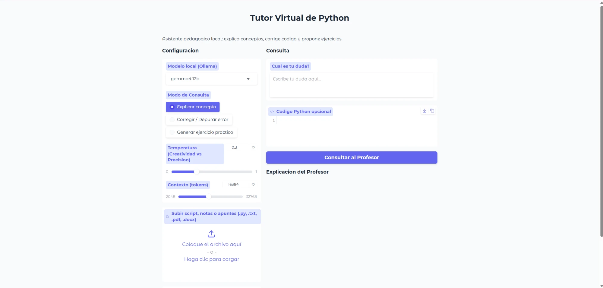
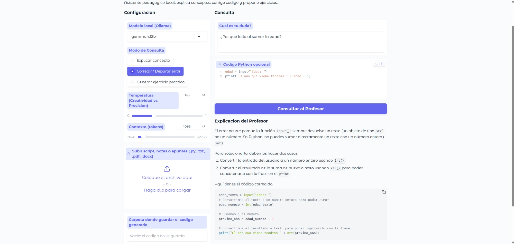
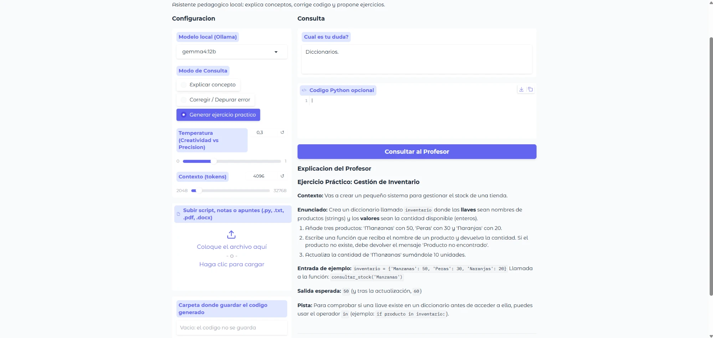
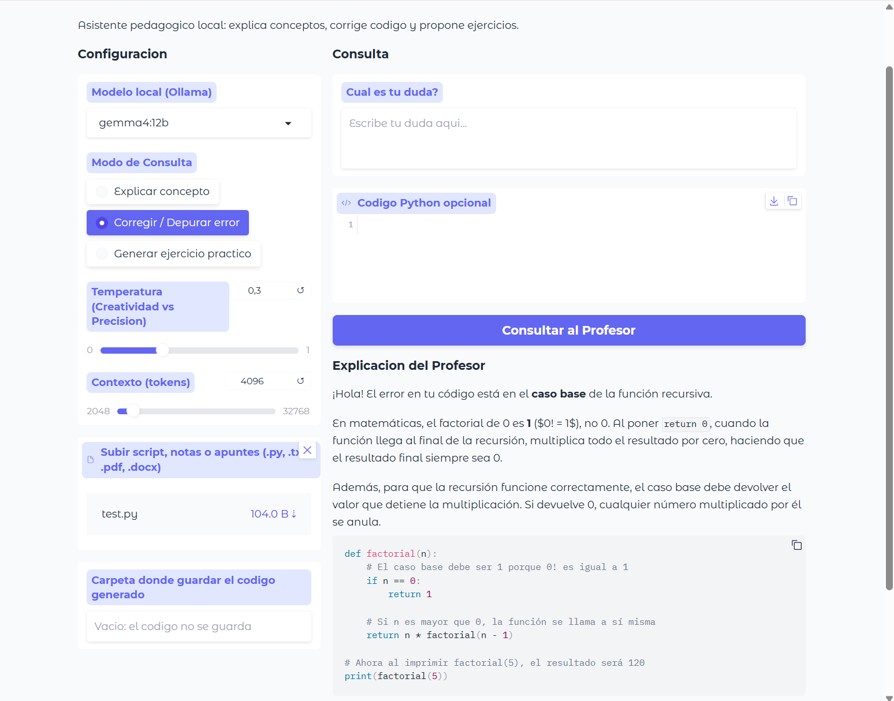
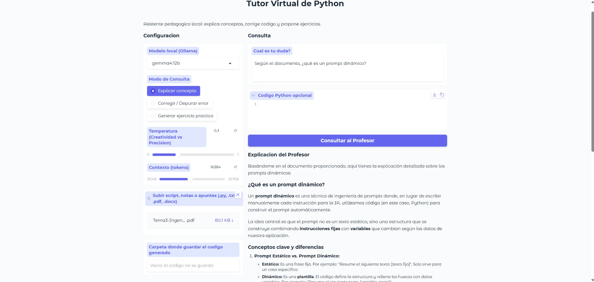
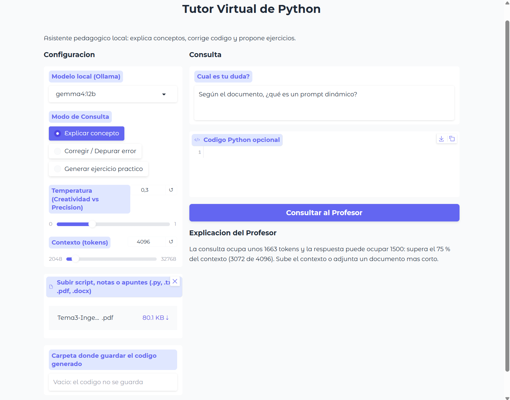
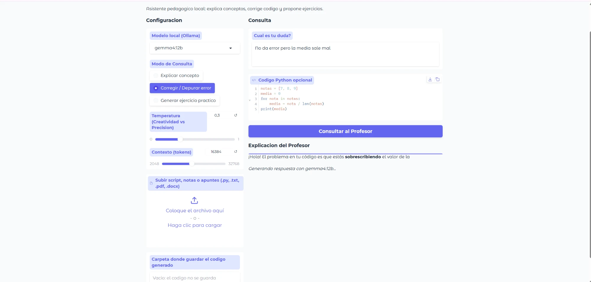
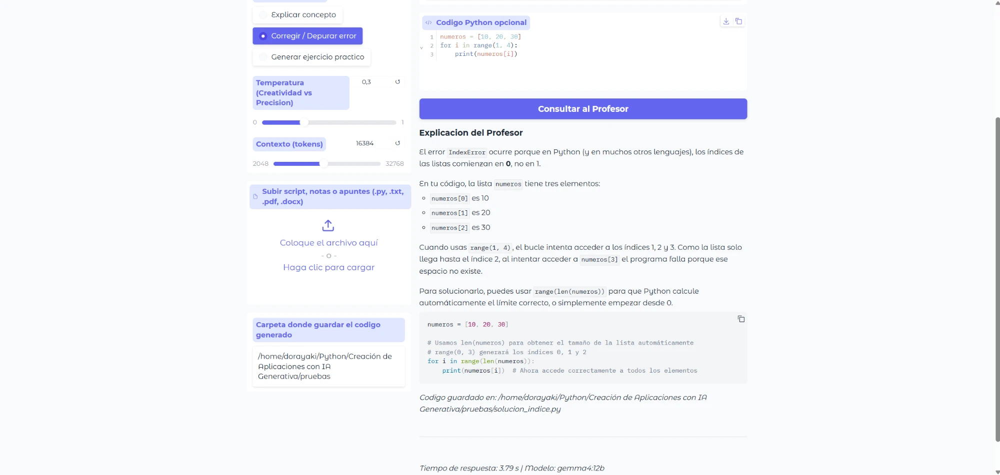
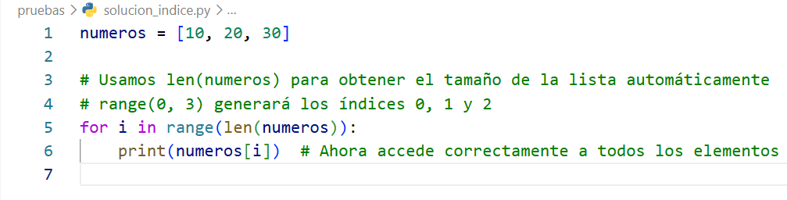
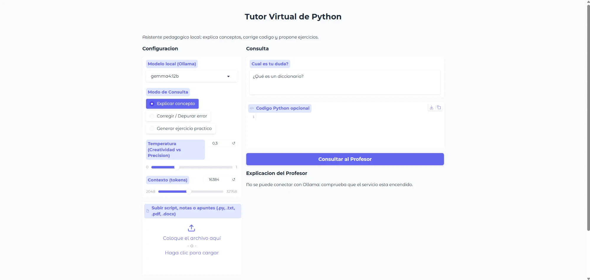

# Tutor Virtual de Python

**Asistente local para aprender Python, hecho con Gradio y modelos de lenguaje de Ollama.**

## 1. Descripción

Proyecto final del curso **Creación de Aplicaciones con IA Generativa**. Es un profesor de Python que funciona en local: el estudiante escribe una duda, puede añadir su código o un documento (apuntes, enunciados, scripts) y un modelo de lenguaje de Ollama le responde de forma pedagógica, en español y con un nivel adaptado a principiantes. Tiene tres modos de consulta:

- **Explicar concepto:** explica paso a paso con ejemplos cortos.
- **Corregir / Depurar error:** indica el fallo, por qué ocurre y devuelve el código corregido.
- **Generar ejercicio práctico:** propone un ejercicio con ejemplo de entrada y salida y una pista, sin la solución.

## 2. Funcionalidades

- Interfaz Gradio con selección de modelo (lista de modelos instalados en Ollama), modo de consulta, temperatura, contexto, archivo adjunto y carpeta de salida.
- Valores iniciales cargados desde `config.yml`, validados y con valores por defecto si hay errores.
- Lectura de documentos como contexto: `.py` y `.txt` directamente; `.pdf` y `.docx` con `officeparserpy`.
- Aviso si la consulta y la respuesta superan el 75 % de la ventana de contexto (conteo aproximado con `tiktoken`).
- Inferencia local con Ollama en **streaming**: la explicación y el código se muestran en la interfaz mientras se generan y, al terminar, se sustituyen por la respuesta validada.
- Validación de la respuesta: JSON válido, claves, tipos y contenido no vacío.
- Respuesta en Markdown, con fórmulas LaTeX y, si se indica una carpeta, el código generado guardado en un archivo `.py`.
- Mensajes de error claros en la interfaz (Ollama apagado, modelo inexistente, tiempo de espera, archivo ilegible).

## 3. Arquitectura

```text
.
├── main.py                    # Interfaz Gradio
├── pipeline.py                # Pipeline: configuración, inferencia y post-procesamiento
├── constants.py               # CSS, modo claro, system prompt fijo e instrucciones por modo
├── config.yml                 # Valores iniciales de la interfaz
├── models/
│   └── pipeline_config.py     # Modelo de datos de la consulta
├── utils/
│   ├── file_utils.py          # Lectura de documentos, escritura de código y config.yml
│   ├── ollama_utils.py        # Lista de modelos y consulta a Ollama
│   └── utils.py               # Conteo aproximado de tokens
├── capturas/                  # Capturas de la interfaz para este README
├── typings/
│   └── officeparserpy/
│       └── __init__.pyi       # Tipos propios de officeparserpy (Pyright strict)
├── pyrightconfig.json         # Pyright en modo strict y ruta de los stubs
├── .gitignore
├── requirements.txt
└── README.md
```

Fases de `pipeline()`:

1. **Configuración:** carga `config.yml`, aplica los valores de la interfaz, valida la entrada, lee el documento, construye el prompt y comprueba el contexto.
2. **Inferencia:** envía el system prompt fijo y el prompt del usuario a Ollama (`format="json"`, `stream=True`) y muestra cada fragmento en la interfaz según llega (`yield`).
3. **Post-procesamiento:** valida el JSON, da formato a la respuesta y guarda el código.

Formato de respuesta pedido al modelo:

```json
{
  "explanation": "Respuesta para el estudiante, en Markdown",
  "file_name": "ejemplo.py",
  "code": "print('Hola')"
}
```

## 4. Requisitos e instalación

Probado con Python 3.14.4 en Ubuntu (WSL) y las versiones de `requirements.txt`. Ollama debe estar instalado y en ejecución.

```bash
python -m venv .venv
source .venv/bin/activate
python -m pip install -r requirements.txt
ollama pull granite4.1:8b
```

`granite4.1:8b` es el modelo por defecto (valor de `PipelineConfig`). Se puede usar cualquier otro modelo instalado cambiando `model` en `config.yml`; conviene elegir uno acorde a la memoria disponible. Para modelos *thinking*, véase `think=False` en las notas de implementación.

## 5. Configuración y uso

Los valores iniciales (modelo, temperatura, contexto, `num_predict`, carpeta de salida y modo) se definen en `config.yml`. Los cambios hechos en la interfaz no modifican el archivo.

- **Contexto:** `context_length` es 16384. La consulta y la respuesta (`num_predict`) deben caber en el 75 % de esa ventana; con 4096 quedaban unos 1500 tokens para la consulta y la mayoría de los PDF superaban el límite. Un contexto mayor consume más memoria, por lo que puede reducirse con el slider de la interfaz.
- **Carpeta de salida:** si la aplicación se ejecuta en Linux o WSL, la ruta debe tener formato Linux (`/home/usuario/carpeta`), no Windows (`\\wsl.localhost\...`). Si contiene `\`, el código no se guarda y se muestra un aviso.

Para iniciar la aplicación:

```bash
python main.py
```

En la URL que muestra Gradio se elige el modelo y el modo, se escribe la duda (opcionalmente con código o un archivo) y se pulsa **Consultar al Profesor**. La respuesta se muestra mientras se genera.

## 6. Notas de implementación

- **Interfaz — `main.py`:** `gr.Blocks` crea la interfaz; el botón envía los valores a `pipeline()` en el orden de la lista `inputs`. El desplegable se rellena con los modelos instalados en Ollama.
- **Configuración — `pipeline_config.py`:** `PipelineConfig` agrupa los valores de `config.yml` y los de la interfaz; `load_parameters` los asigna por posición, así que si cambia el orden de `inputs` hay que cambiarlo también aquí.
- **Prompts — `constants.py` y `pipeline.py`:** el system prompt es fijo (rol de tutor, reglas y esquema JSON) y no se puede editar desde la interfaz; el prompt del usuario se construye con el modo, la extensión máxima, la duda, el código y el documento.
- **Validación — `pipeline.py`:** se comprueba la entrada, el tamaño del contexto y la respuesta (JSON válido, claves, tipos y contenido). Los errores se muestran en la interfaz.
- **`think=False`:** con modelos *thinking* (p. ej. `gemma4:12b`), el razonamiento previo consumía tokens de `num_predict` y cortaba el JSON, así que se desactiva en `ollama_chat` (`utils/ollama_utils.py`). Para activarlo, se cambia `think` a `True` en ese archivo y se aumenta `num_predict` en `config.yml`.
- **Streaming:** `ollama_chat` devuelve los fragmentos de Ollama y `pipeline` es un generador: cada `yield` actualiza la caja de respuesta de Gradio. Como un JSON a medias no se puede leer con `json.loads`, `extraer_campo_parcial` cierra las comillas del campo que se está escribiendo para mostrar la explicación y el código según llegan. La validación completa se hace al final.
- **Tipado:** el proyecto está escrito para Pyright en modo *strict* (`pyrightconfig.json`). Como `officeparserpy` no incluye tipos, se añadió un stub propio en `typings/officeparserpy/__init__.pyi`. La única etiqueta `ignore` está en `cliente.chat`, porque la librería `ollama` tipa el parámetro `tools` con un `Callable` sin tipo.
- **Fórmulas LaTeX:** `gr.Markdown` solo reconoce `$$...$$` por defecto; con `latex_delimiters` también se muestran correctamente `$...$`, `\(...\)` y `\[...\]`, que son los que suelen usar los modelos.
- **Modo claro:** el tema `soft` sigue el modo oscuro del sistema; `Constants.LIGHT_MODE_JS` recarga la página con `?__theme=light` para que el fondo sea siempre blanco.

## 7. Limitaciones

- Un JSON válido no garantiza una respuesta correcta: el código generado debe revisarse antes de ejecutarlo.
- **Fallos observados:**
  - `gemma4:12b` devolvió una vez *"prediction aborted, token repeat limit reached"* en el modo "Explicar concepto"; al repetir la consulta funcionó.
  - Si la respuesta llega a `num_predict`, el JSON queda cortado y la aplicación muestra el aviso de JSON no válido.
  - En alguna respuesta el modelo escribió `\\n` dentro del JSON en lugar de `\n`, y en la interfaz apareció el texto `\n` en vez de un salto de línea.
  - En una corrección el modelo escribió `\for` en lugar de `\nfor` dentro del JSON. `\f` es un escape válido (salto de página), así que el JSON pasó la validación, pero la línea `for` quedó unida al comentario anterior y el código guardado no funcionaba (`NameError`). Es un ejemplo de que la validación estructural no garantiza un código correcto.
- El conteo de tokens es aproximado (`cl100k_base`), y la primera vez `tiktoken` necesita conexión a internet para descargar la codificación.
- Los PDF que solo contienen imágenes no producen texto (no hay OCR).
- Si se repite el nombre de archivo, el código guardado sobrescribe el anterior.
- Al reconocer `$...$` como fórmula, dos signos `$` en un texto normal (por ejemplo, dos precios) pueden mostrarse como una fórmula.

## 8. Mejoras futuras

- Historial de conversación.
- Dividir documentos largos en fragmentos (chunking).

## 9. Capturas

**Interfaz inicial.** Configuración a la izquierda (modelo, modo, temperatura, contexto, archivo y carpeta de salida) y consulta a la derecha.



**Corregir / Depurar error.** Explica el `TypeError` al sumar texto y número y devuelve el código corregido con comentarios.



**Generar ejercicio práctico.** Ejercicio sobre diccionarios con enunciado, entrada y salida de ejemplo y pista, sin la solución.



**Archivo `.py` adjunto.** Sin escribir ninguna duda, detecta el caso base incorrecto de una función recursiva.



**Documento PDF como contexto.** Responde a una pregunta usando el texto extraído del PDF.



**Aviso de contexto.** Con un contexto de 4096 tokens, el PDF no cabe en el 75 % de la ventana y la consulta no se envía al modelo.



**Streaming.** La explicación aparece en la interfaz mientras el modelo la genera.



**Código guardado.** Con una carpeta de salida, el código corregido se guarda en un archivo `.py` y se indica su ruta.



**Archivo generado.** El archivo `solucion_indice.py` guardado en la carpeta de salida, listo para ejecutarse.



**Error de conexión.** Con Ollama detenido, la interfaz muestra un mensaje claro en lugar de fallar.



## 10. Autoría

**Laura Álvarez Zamora** - Ingeniera Informática y estudiante del curso **Creación de Aplicaciones con IA Generativa** (2026).
Basado en el repositorio de *Manuel Alejandro Bacallado López* para el programa Capacita.
